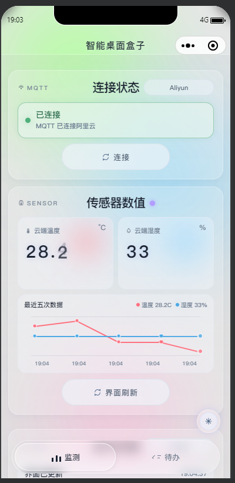
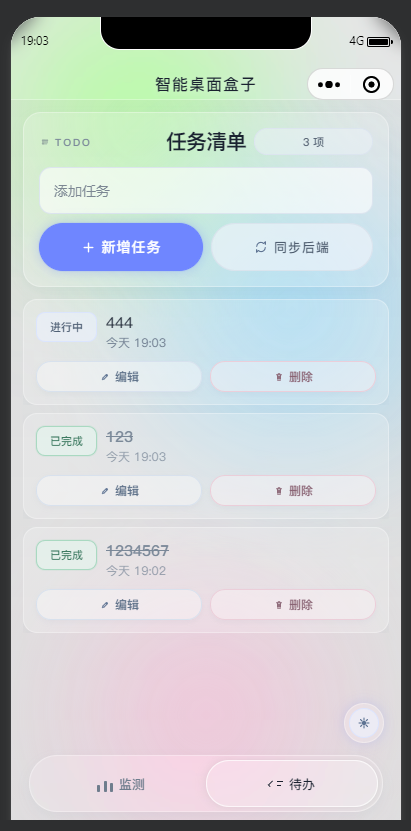

# 智能桌面盒子 · 微信小程序

智能桌面盒子的移动控制端：通过 MQTT over WebSocket 观察温湿度，通过 REST API 和 WebSocket 管理与同步待办，并提供明暗主题和本地缓存。

这是一个软硬件协同项目的组成部分，不是三个互不相关的项目：

| 组件 | 职责 | 仓库 |
| --- | --- | --- |
| 微信小程序（本仓库） | 监测、待办管理、缓存与移动交互 | [wechat_code](https://github.com/baishang-ui/wechat_code) |
| Node.js 后端 | 待办持久化、推送与设备同步 | [backend](https://github.com/baishang-ui/backend) |
| STM32 固件 | 传感器、OLED、USB HID 与联网 | [end_stm32](https://github.com/baishang-ui/end_stm32) |

> **安全状态**：这是原型工程。现有配置与 Git 历史需要按 [安全说明](SECURITY.md) 检查并轮换凭据；不要直接使用历史凭据或连接未授权的云端服务。本次文档整理不代表安全问题已修复。

## 项目截图

以下图片来自毕业设计保存的历史运行截图，不是本次重新运行所得。传感器数值、连接状态和待办内容均是截图当时的状态。

<p>
  
  
</p>

## 功能与工程实现

- 内置 MQTT 3.1.1 客户端接收云端温湿度消息，展示最近五次趋势和运行日志。
- 待办新增、行内编辑、完成和删除；后端最多保留 5 条未删除待办。
- 监听 `todo.snapshot`、`todo.upsert` 和 `todo.delete` 推送，更新界面并处理断线重连。
- 勾选与删除先更新界面，再根据后端结果校准；这不等于完整的离线写入队列。
- 缓存传感器读数、历史和主题偏好，支持明暗主题与安全区适配。
- JavaScript、WXML、WXSS；MQTT 和签名工具直接包含在源码内，没有 NPM 安装步骤。

## 本地打开

1. 安装微信开发者工具，克隆本仓库。
2. 导入仓库根目录，使用自己获授权的 AppID。当前工程配置的基础库为 `3.15.0`，其他版本需自行验证。
3. 先检查 `utils/aliyunConfig.js` 和 `utils/backendConfig.js`，不要使用历史配置中的凭据。设备、Topic 和后端地址必须来自你有权操作的测试环境。
4. 若只联调待办，先按 [后端说明](https://github.com/baishang-ui/backend#readme) 启动隔离的本地服务，再配置自己的后端地址和令牌。
5. 编译并检查监测页、待办页、明暗主题、断线重连与错误提示。

手机上的 `localhost` 不是开发电脑。优先填写手机可达的后端地址，不要假定自动探测一定能找到服务器。正式使用时配置合法的 HTTPS/WSS 域名和证书，不以关闭域名校验作为发布方案。

### 配置入口

| 文件 | 需要检查的字段 | 注意事项 |
| --- | --- | --- |
| `utils/aliyunConfig.js` | 地域、设备身份、Topic、TLS | 分发到客户端的设备凭据无法视为长期秘密 |
| `utils/backendConfig.js` | `baseUrl`、`protocol`、`port`、`apiToken` | 与测试后端认证一致，不提交真实令牌 |
| `project.config.json` | AppID 与基础库 | 使用你有权调试的项目配置 |

后端地址解析会尝试显式地址、缓存地址、基于网络信息的候选地址及本地回退地址。自动推导不保证目标机器实际运行了服务。

## 接口与数据约定

| 方法 | 路径 | 用途 |
| --- | --- | --- |
| GET | `/api/todos` | 获取 `{ items: Todo[] }` |
| POST | `/api/todos` | 创建待办，请求体含 `title` |
| PATCH | `/api/todos/:id` | 修改 `title` 或 `completed` |
| DELETE | `/api/todos/:id` | 删除待办 |
| WebSocket | `/ws/todos` | 接收快照与增量变更 |

后端待办对象包含 `id`、`title`、`completed`、`deleted`、`source`、`createdAt`、`updatedAt`、`deletedAt` 与 `version`。时间字段来自 SQLite 毫秒时间戳，不是统一的 ISO 字符串。

传感器消息支持 `temp` 和 `humi` 字段；实际 Topic 必须与自有设备及云端规则一致。示例值不代表当前传感器数据。

## 代码导航

```text
app.json                页面注册与窗口配置
pages/index/            监测、待办、主题与交互
assets/icons/           SVG 图标
utils/aliyunConfig.js   IoT 配置入口
utils/backendConfig.js 后端地址与连接配置
utils/mqttClient.js    MQTT 报文与 WebSocket 连接
utils/sha256.js        SHA-256 / HMAC-SHA256
utils/storage.js       本地缓存
docs/images/           已有历史截图
```

## 验证边界

仓库当前没有自动化测试命令或独立 Web 构建。Node.js 语法检查只能发现 JavaScript 语法错误，不能证明微信专有 API、网络权限、云端通信或设备联调可用。

本次整理核对了源码与文档，并加入历史截图；没有重新执行微信模拟器或实物端到端测试。请在自己的开发者工具和测试设备中验证后再发布。

## 使用与授权

仓库没有独立的 `LICENSE` 文件；公开可读不等于可以推断完整的再分发授权。使用第三方代码时应保留其原始声明；其他授权范围请联系维护者确认。
